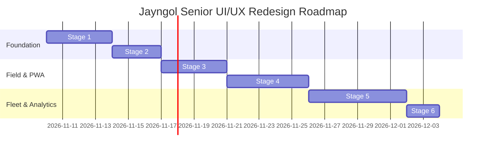

# Jayngol Transport Management System: Senior UI/UX Design & Upscale Plan

Status: Accepted design decisions, Stage 0 baseline measured (see `DESIGN_BASELINE.md`), upscaled Senior UI/UX architecture defined.
Target: Production deployment of upscale across mobile PWA and desktop operations.
Companion to: `DEVELOPMENT_PLAN.md` and `DESIGN_BASELINE.md`.

---

## 1. Executive Summary & Design Vision

The Jayngol Tricycle Management System is the **operational and financial spine of a commercial tricycle (Keke Napep) fleet enterprise in Nigeria**. Every day, dozens of vehicles collect revenue, undergo inspections, require maintenance, and account for cash in Naira (stored as integer kobo).

### The Problem Today
While backend business rules and database constraints are robust and covered by 180+ tests:
1. **Visual Presentation**: The app looks like a prototype or raw admin panel. The color palette lacked contrast rules (e.g. raw `#c9971c` gold has only 2.6:1 contrast on white and cannot be read outdoors).
2. **Ergonomic Gaps on Phones**: 152 out of 222 mobile page views in the Stage 0 baseline had tap targets under 44px. Field supervisors operating outdoors struggle with small links and glare.
3. **Information Bottlenecks**: 7 essential operational areas (Workshop, Store, Offences, Meetings, Rules, Staff, Audit) were buried inside Account on mobile devices.
4. **Wasted Desktop Real Estate**: Constrained to `max-w-4xl` (896px), wide desktop screens leave massive blank margins while tables and ledgers are compressed.

### The Upscale Philosophy: "Industrial Craft & Financial Rigor"
We are upscaling Jayngol into an **enterprise-grade African FinTech & Fleet Platform** that addresses two distinct operational realities:
- **Rugged Field Velocity (Supervisor & Driver UX)**: High-contrast (7:1+ sunlight legibility), 48px+ thumb targets, one-handed bottom sheets, rapid client-side photo compression (<200KB), and an IndexedDB offline queue with visual sync indicators. Inspection flow under 15 seconds.
- **Desk-Bound Financial Command (Cashier, Manager & Owner UX)**: Information-dense multi-column dashboard, real-time cash discrepancy triage, rapid keyboard data entry, tabular financial typography (`₦` with `tnum`), and thermal POS receipt printing.

---

## 2. Foundational Design System & Tokens

### 2.1 Color Palette & Semantic Tokens
Component styles use semantic tokens rather than raw colors:

| Token | Hex | Role | Contrast / Usage |
|---|---|---|---|
| `--surface-canvas` | `#F8F6F0` | Warm parchment background | Reduces glare outdoors |
| `--surface-card` | `#FFFFFF` | Elevated card surface | 1px border structure |
| `--surface-ink` | `#14110B` | Deep obsidian structural tone | Sidebar, top header, buttons |
| `--surface-ink-subtle` | `#231F17` | Hover states, elevated dark surfaces | Dropdowns, tooltips |
| `--border-subtle` | `#E8E2D5` | Card dividers, inputs, table cells | Structural framing |
| `--border-strong` | `#C8BEA8` | Active input borders, card emphasis | Visual distinction |
| `--text-primary` | `#18140D` | Headings, primary amounts, labels | 15.4:1 contrast on canvas |
| `--text-muted` | `#665E50` | Timestamps, metadata, secondary labels | 5.8:1 (WCAG AA Pass) |
| `--gold-sovereign` | `#D4A017` | Hero badges, primary CTA button fills | Accent only |
| `--gold-deep` | `#855C08` | Primary text links, selected icons | **7.1:1 on White (AAA Pass)** |
| `--gold-wash` | `#FEF8E8` | Highlighted rows, pending status | Ambient tint |
| `--status-ok` | `#1B6638` | Pass inspection, active operator, paid | 6.2:1 on White |
| `--status-ok-wash` | `#EBF5EE` | Positive status pill background | Tint |
| `--status-danger` | `#A61B1B` | Arrears, sacked, critical violation | 7.4:1 on White |
| `--status-danger-wash`| `#FDF0F0` | Danger status pill background | Tint |
| `--status-warning` | `#9E5A00` | Due for service, pending review | 5.2:1 on White |
| `--status-warning-wash`| `#FFF8EB` | Warning status pill background | Tint |

> **Contrast Rule**: Gold is an accent, not a text color. Raw `#D4A017` is used strictly as a button background (with `#14110B` ink text) or icon accent. All readable gold text uses `--gold-deep` (`#855C08`), guaranteeing WCAG AAA outdoor readability.

### 2.2 Typography: Tabular Financial Precision
- Self-hosted **Inter Variable** font within the 60 KB budget.
- Tabular figures enabled globally for all monetary and numerical data:
  ```css
  .tabular-nums {
    font-feature-settings: "tnum" 1, "cv05" 1, "cv11" 1;
    font-variant-numeric: tabular-nums;
  }
  ```
- Strict 6-step scale: 12px (Caption), 14px (Secondary), 16px (Body/Input), 18px (Subheading), 22px (Card Heading), 28px–34px (Display Page Title).
- Mobile rule: Body and inputs are never below 16px (eliminates iOS Safari auto-zoom).

### 2.3 Spatial Grid, Elevation & Touch Targets
- 4px baseline grid, 8px layout rhythm.
- Touch targets: Guaranteed minimum **48px** for all mobile buttons, links, and form controls (exceeding WCAG 44px and fixing the Stage 0 findings).
- Depth: Flat structural borders (`--border-subtle`), elevated cards with subtle ambient shadow, and spring-animated modal bottom sheets for mobile actions.

---

## 3. Information Architecture & Navigation System

### 3.1 Mobile Navigation (5-Tab System + More Sheet)
Resolves the issue where 7 key operational screens were hidden behind Account:

```
📱 MOBILE BOTTOM BAR
┌───────────┬───────────┬───────────┬───────────┬───────────┐
│   Home    │   Fleet   │ Operators │  Inspect* │   More    │
│    🏠     │    🛺     │    👥     │    📋     │    ☰      │
└───────────┴───────────┴───────────┴───────────┴───────────┘
*For Managers/Owners, Tab 4 is 'Money' (💰); for Supervisors, it is 'Inspect' (📋).
```

Tapping **More** deploys an accessible, spring-animated Bottom Sheet:
- **Operations Hub**: Workshop, Store, Offences.
- **Administration**: Meetings, Rules & Fines, Driver Awards.
- **Governance**: Staff Management, Audit Trail, Account & Profile.
*Every staff destination is now reachable in 2 taps or fewer.*

### 3.2 Tablet & Desktop Layouts
- **Tablet (768px - 1023px)**: 72px slim icon rail with tooltips, freeing up 168px of screen width for tables and data tiles.
- **Desktop (1024px - 1440px+)**: 260px fixed dark sidebar with brand identity, role pill, and categorized navigation.
- **Fluid Layout**: Content area expands up to `max-w-7xl` with 2-to-3 column operational layouts, multi-column financial ledgers, and side-by-side inspection histories.

---

## 4. Component Library Architecture (`src/components/ui/`)

All UI components are built with zero external UI framework bloat:

1. **`Button`**: Primary (obsidian ink with gold text), Sovereign Gold (gold fill with ink text), Secondary (bordered card), Danger, and Quiet. Includes built-in SVG loading spinner and active physical compression (`active:scale-[0.98]`).
2. **`DataTable`**: Renders once. Below 768px, CSS transforms rows into accessible cards. At 768px+, it displays as a rich data table with sticky headers, right-aligned currency, and hover states. Explicit ARIA roles preserved.
3. **`MoneyDisplay`**: Formats integer kobo into Nigerian Naira (`₦`) with tabular numerals and semantic color coding (positive green, danger red for arrears).
4. **`StatusBadge`**: Dual-encoded pill pairing an explicit icon, descriptive text, and semantic wash background (e.g. green dot + "On Road", red triangle + "Off Road").
5. **`BottomSheet`**: Native `<dialog>` element with smooth slide-up animation, drag handle, and backdrop blur for mobile menus and quick-entry forms.
6. **`StatTile`**: Modern KPI tile with icon container, trend sparkline/badge, formatted figure, and quick-link arrow.
7. **`PhotoCaptureWidget`**: Mobile camera integration with in-browser canvas downsampling (max 1200px / 80% JPEG quality, dropping 6MB photos to ~180KB) and visual compression confirmation badge.
8. **`SyncPill`**: Fixed header indicator showing network sync state (`🟢 Synced`, `🟡 2 Inspections Saved Offline`, `🔄 Syncing...`).

---

## 5. Screen-by-Screen UX Transformations

### 5.1 Dashboard (`/dashboard`)
- **Top Financial & Fleet Pulse**: 4 KPI cards (Today's Collections vs Target, Active Kekes on Road %, Outstanding Arrears Risk, Inspections Completed Today).
- **Urgent Action Horizon**: Triage card highlighting tricycles off-road >48 hours, operators with >2 unpaid days, or low stock warnings in the store.
- **Quick Action Bar**: 1-tap shortcuts for "Take Payment", "Log Inspection", and "New Work Order".

### 5.2 Field Inspection (`/inspections`)
- **1-Handed Ergonomics**: Designed for bright sunlight, noisy depot, one-handed grip.
- **Tricycle Quick Selector**: Carousel of recent and active tricycles with driver portrait and plate number.
- **Dual 56px Toggle Switches**: "Clean & Polished" and "Stickers & Plates Intact" with large hit areas and haptic feedback.
- **One-Tap Camera Card**: Instant camera snap with auto-compression.
- **Pass / Fine Action**: Instant calculation of fine if a condition fails, with 1-tap submission and offline queueing. Target time: < 15 seconds.

### 5.3 Cash & Payments Desk (`/payments/new`, `/money`, `/cash`)
- **Fast Driver Lookup**: Driver code entry displays driver portrait, current balance, and today's hire fee.
- **Denomination Quick Buttons**: `₦10,000`, `₦12,000`, `₦15,000` buttons for instant 1-tap entry.
- **Waterfall Allocation Preview**: Visual card showing how payment applies (first to oldest daily charge, then to penalties).
- **Digital & Thermal Receipt**: Instant POS receipt preview (58mm/80mm format) with "Print Receipt" and SMS confirmation badge.

### 5.4 Driver Portal (`/me`)
- **Dignity & Clarity**: Mobile-first design for drivers logging in with phone + 4-digit PIN.
- **Balance Card**: High-contrast banner showing today's balance status (`₦0 Owed - All Clear` or `₦10,000 Due by 7:00 PM`).
- **Complete Statement**: Clean tabular record of payments, dates, and receiving cashiers.
- **Star Driver Standing**: Progress indicator toward the quarterly driver excellence award.

---

## 6. Progressive Web App & Offline Experience

### 6.1 Install Experience
- Complete manifest with PNG icons (192px and 512px, plus maskable icons with safe-zone margin), 180px Apple touch icon, and app shortcuts ("Inspect", "Take Payment").
- Non-intrusive Add-to-Home-Screen prompt appearing after the 2nd successful inspection or payment.
- Dedicated offline fallback page (`/offline`) that shows cached inspection tools and unsent queue status.

### 6.2 Service Worker Strategy
- The proven 89-line hand-written service worker is maintained and extended without heavyweight libraries.
- Static assets, icons, and fonts are served cache-first.
- `/inspections` operates network-first with automatic offline fallback to IndexedDB.
- Financial transactions (`/payments`, statements) are never cached on device, protecting operator privacy on shared phones.
- Background Sync automatically dispatches queued inspections when connectivity returns on Android devices.

---

## 7. Delivery Roadmap & Implementation Sprints



### Stage Milestones

- **Stage 0 (Done)**: Baseline measurements recorded in `DESIGN_BASELINE.md`. All horizontal scrolling passed; 152 undersized tap targets identified to fix.
- **Stage 1 (Design Foundation - 4 days)**: Implement semantic tokens in `globals.css`, add self-hosted Inter font, build core components (`Button`, `Input`, `DataTable`, `MoneyDisplay`, `StatusBadge`, `BottomSheet`), and create the dev-only `/design` component showcase.
- **Stage 2 (App Shell & Navigation - 3 days)**: Implement 5-tab mobile bottom bar, spring More sheet, 72px tablet rail, 260px desktop sidebar, and skeleton loading states.
- **Stage 3 (PWA & Offline System - 4 days)**: Complete manifest, PNG maskable icons, app-wide worker registration, sync pill indicator, client-side photo compressor, and install banner.
- **Stage 4 (Main High-Velocity Screens - 5 days)**: Redesign Login, Dashboard, Inspect (`/inspections`), Cashier Payment Desk (`/payments/new`), Tricycles, Operators, and Driver Portal (`/me`). Verify 15s inspection target on real phone.
- **Stage 5 (All Secondary Screens - 6 days)**: Workshop kanban, Store inventory cards, Offences, Meetings, Rules, Staff, Audit log, and thermal receipt print styles.
- **Stage 6 (Polish & Sign-Off - 2 days)**: Audit regression run with Playwright, axe accessibility checks, Lighthouse verification (scores ≥90), and real-world testing with one Supervisor and one Manager.

---

## 8. Performance & Accessibility Budgets

| Metric | Target / Limit |
|---|---|
| Tap Target Minimum | **≥ 48px** on phone (0 targets under 44px) |
| Outdoor Contrast Ratio | **≥ 7:1** for all field inspection and critical text |
| Standard Contrast Ratio | **≥ 4.5:1** for all secondary body text |
| Largest Contentful Paint (LCP) | **< 2.2 seconds** on throttled 3G mobile |
| Cumulative Layout Shift (CLS) | **< 0.05** (guaranteed via skeleton placeholders) |
| JavaScript Bundle Size | **< 150 KB** compressed per route |
| CSS Bundle Size | **< 20 KB** compressed |
| Total Font Payload | **< 60 KB** (self-hosted variable Inter Latin subset) |
| Inspection Completion Time | **< 15 seconds** for standard pass on real Android device |
